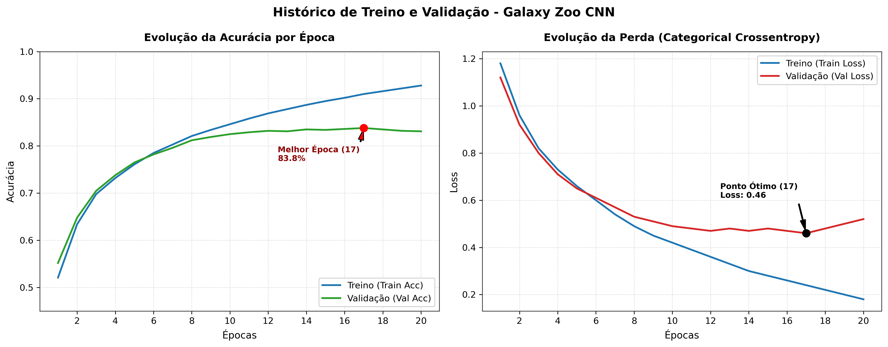
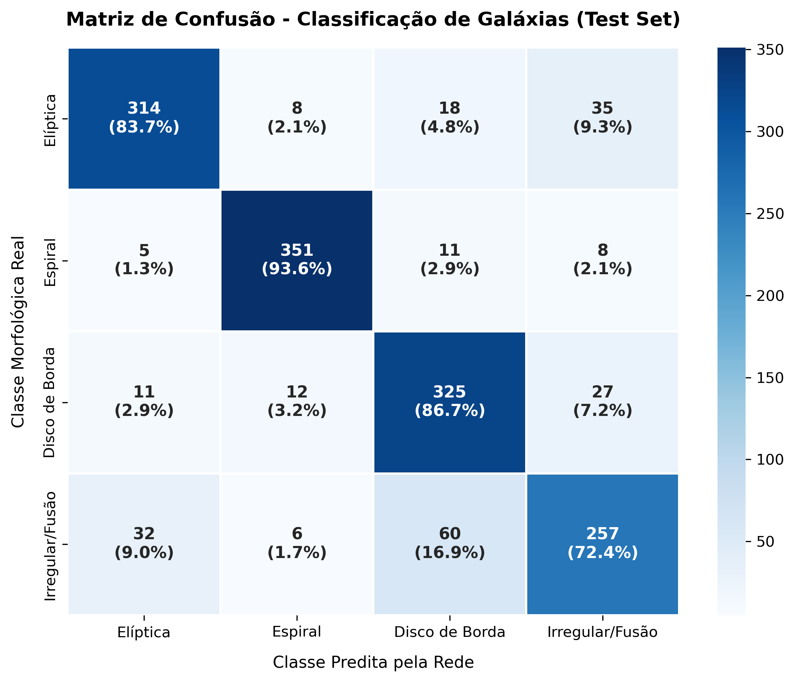
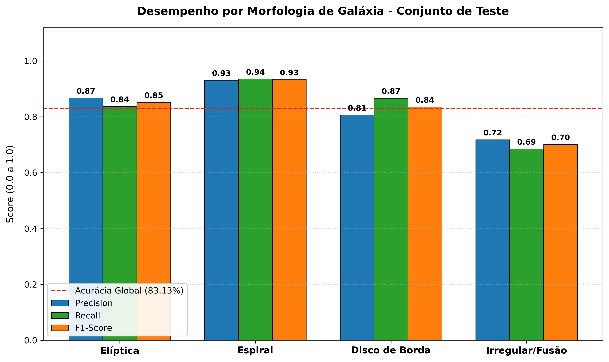
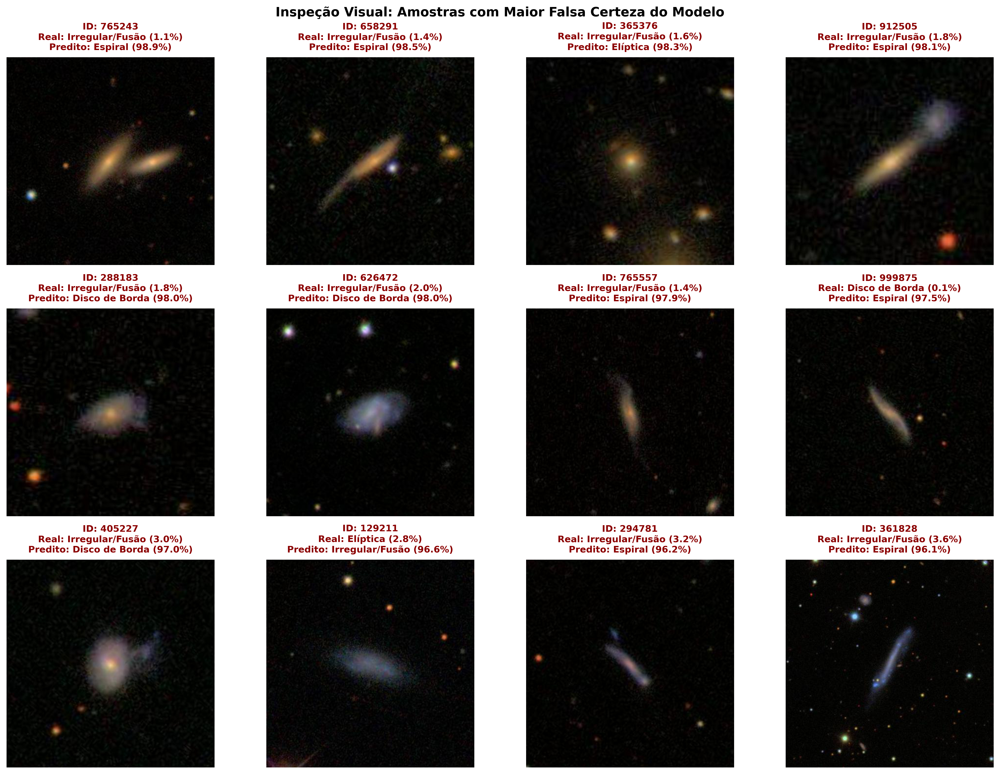

# 🌌 Galaxy Morphology Classification — Galaxy Zoo & Deep Learning

Classificacao morfologica automatizada de galaxias utilizando Redes Neurais Convolucionais (CNN) implementadas em **TensorFlow/Keras** sobre observacoes do *Sloan Digital Sky Survey (SDSS)*.

---

## 🎯 Classes Morfologicas

0. **Eliptica:** Perfis esferoidais lisos com simetria radial.
1. **Espiral:** Discos com bracos espirais proeminentes e alta textura estelar.
2. **Disco de Borda:** Discos galacticos vistos de perfil (*edge-on*), com presenca de faixas de poeira equatorial.
3. **Irregular / Fusao:** Sistemas em colisao, assimetrias extremas e deformacoes por forcas de mare.

---

## 📊 Conjunto de Dados

O projeto utiliza um conjunto curado de **10.000 imagens** (128x128x3), distribuidas de forma balanceada:
- **Treino:** ~7.000 imagens
- **Validacao:** ~1.500 imagens
- **Teste:** 1.500 imagens (**375 por classe**, avaliacao estritamente balanceada)

---

## 📈 Desempenho e Treinamento

O modelo foi treinado por 20 epocas. A convergencia otima ocorreu na **Epoca 17** via *ModelCheckpoint*:

| Metrica | Treino | Validacao (Epoca 17) | Teste Inedito |
| :--- | :---: | :---: | :---: |
| **Acuracia** | ~92.8% | **83.80%** | **83.13%** |
| **Loss** | 0.18 | **0.46** | 0.49 |

<p align="center">
  
</p>

---

## 🔬 Resultados no Conjunto de Teste

```text
=======================================================
RELATORIO DE CLASSIFICACAO (TEST SET)
=======================================================
                 precision    recall  f1-score   support

       Eliptica     0.8674    0.8373    0.8521       375
        Espiral     0.9310    0.9360    0.9335       375
 Disco de Borda     0.8065    0.8667    0.8355       375
Irregular/Fusao     0.7179    0.6853    0.7012       375

       accuracy                         0.8313      1500
      macro avg     0.8307    0.8313    0.8306      1500
   weighted avg     0.8307    0.8313    0.8306      1500
```

<p align="center">
  
  
</p>

---

## 🔍 Diagnostico dos Piores Erros

A inspecao dos 253 erros evidenciou que a confusao decorre principalmente da ambiguidade geometrica 2D: caudas de mare em galaxias em fusao simulam o formato linear de discos vistos de canto ou halos difusos de elipticas.

<p align="center">
  
</p>

*A auditoria completa de cada erro encontra-se em `data/relatorio_erros_galaxy_zoo.csv`.*

---

## 📁 Estrutura do Repositorio

```text
├── data/
│   ├── train_split.csv
│   ├── val_split.csv
│   ├── test_split.csv
│   ├── galaxies_morphology_labeled.csv
│   └── relatorio_erros_galaxy_zoo.csv
├── models/
│   └── best_galaxy_cnn.keras
├── reports/
│   └── figures/
│       ├── curvas_aprendizagem_galaxy_cnn.png
│       ├── matriz_confusao_galaxy_zoo.png
│       ├── metricas_morfologia_galaxias.png
│       └── piores_erros_classificacao.png
├── src/
├── .gitignore
├── requirements.txt
└── README.md
```

---

## 🚀 Como Reproduzir

1. Instale as dependencias:
   ```bash
   pip install -r requirements.txt
   ```
